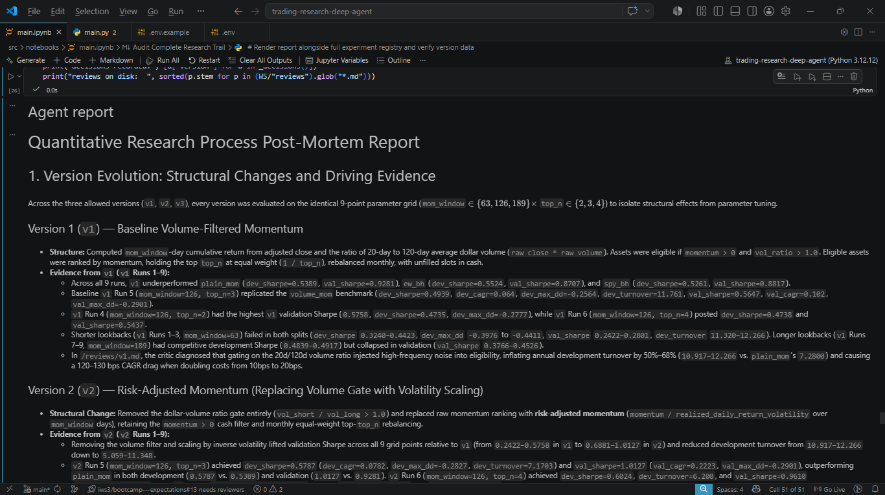
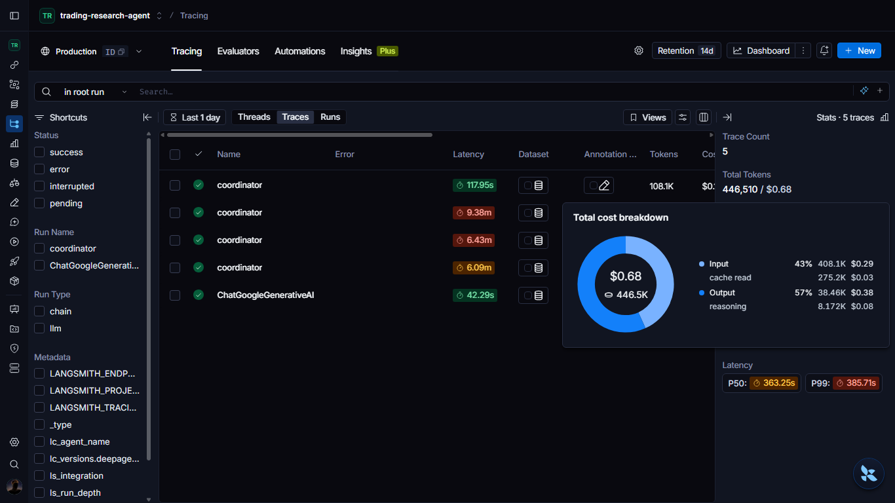
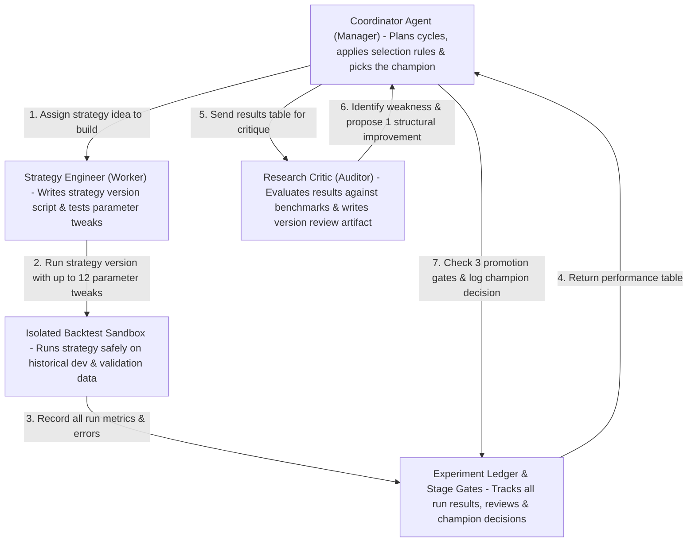
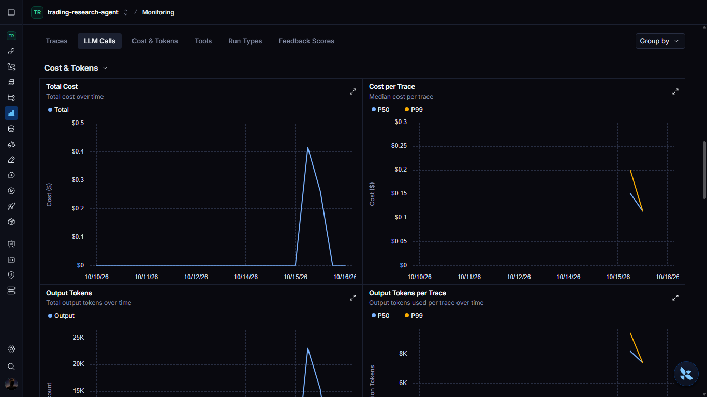
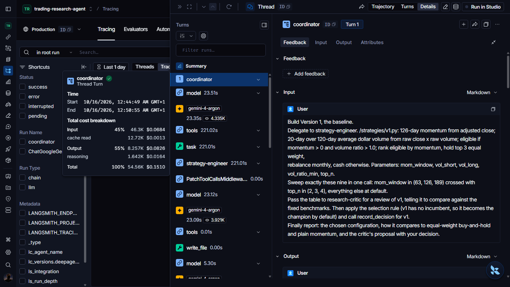

# Multi-Agent Quantitative Trading Research System

[](docs/DATA_PROVIDERS.md)
[](https://www.freecodecamp.org/news/build-a-multi-agent-trading-research-system-with-langchain-deep-agents-handbook/)
[](https://www.python.org/)
[](https://github.com/langchain-ai/deepagents)
[](https://langchain-ai.github.io/langgraph/)
[](https://cloud.google.com/vertex-ai)
[](https://smith.langchain.com/)

|  |  |
| :---: | :---: |
| *Final post-mortem audit report rendered in `main.ipynb` after completing all 3 strategy versions and unlocking the holdout split* | *LangSmith root trace breakdown showing multi-agent execution latency and total token usage ($0.68 across 446.5K tokens)* |

---

## Overview & Core Philosophy

When autonomous LLM agents are tasked with discovering quantitative trading strategies in an unconstrained loop, they naturally gravitate toward **overfitting, data snooping, and self-justification**—tuning parameters until historical backtest numbers look impressive while destroying out-of-sample validity.

This project implements a **stage-gated, multi-agent quantitative trading research system** built with **LangChain Deep Agents**, **LangGraph**, and **Google Gemini**.

> **The Goal:** Create an environment where autonomous agents can generate, test, and challenge quantitative trading ideas **without controlling the evidence used to judge them**.

To achieve this, the system separates **hypothesis generation and critique** (handled by specialized LLM agents) from **portfolio accounting, benchmarking, sandboxing, and promotion rules** (enforced by a deterministic Python evaluation layer). Agents can write strategy logic and argue over results, but they cannot alter the backtester, hide failed runs, bypass stage gates, or peek at the holdout period.

> [!NOTE]
> Execution outputs and cached market data from my full run of the pipeline are available in [`docs/data_and_agent_workspace_files/project`](docs/data_and_agent_workspace_files/project) and [`docs/data_and_agent_workspace_files/raw_cache`](docs/data_and_agent_workspace_files/raw_cache).

---

## Getting Started & Setup

### 1. Prerequisites
- **Python 3.12+**
- [**`uv`**](https://docs.astral.sh/uv/) (recommended) or standard `pip`/`venv`
- A free [**Tiingo API Key**](https://www.tiingo.com/) (or see [`docs/DATA_PROVIDERS.md`](docs/DATA_PROVIDERS.md) to use `yfinance` without a key)
- A **Google Gemini API Key** (or **Google Cloud Agent Platform / Vertex AI** project credentials)
- A [**LangSmith API Key**](https://smith.langchain.com/) (optional, for tracing and observability)

### 2. Installation

Clone the repository and install dependencies:

```bash
git clone <your-repo-url>
cd trading-research-deep-agent

# Using uv (recommended)
uv sync

# Or using standard venv + pip
python -m venv .venv
source .venv/bin/activate  # On Windows: .venv\Scripts\activate
pip install -r requirements.txt
```

### 3. Environment Configuration

Copy [`.env.example`](.env.example) to `.env` and fill in your API keys and configuration values:

```bash
cp .env.example .env
```

### 4. Running the Research System

You can run the full pipeline either as a standalone Python script or interactively cell-by-cell in Jupyter:

**Option A — Run via Python CLI:**
```bash
uv run python src/main.py
```

**Option B — Run Interactive Notebook:**
Open [`src/notebooks/main.ipynb`](src/notebooks/main.ipynb) in VS Code, Cursor, or Jupyter Lab and execute the cells sequentially using the `.venv` kernel.

---

## System Architecture & The Agent Team

The research workflow runs across three strictly gated iterations (`v1` $\rightarrow$ `v2` $\rightarrow$ `v3`) over a 9-ETF US equity and sector universe (`SPY`, `QQQ`, `IWM`, `XLE`, `XLF`, `XLK`, `XLV`, `XLP`, `XLY`), followed by a one-shot out-of-sample holdout evaluation and a post-mortem audit.



### The Three Agents

| Agent Role | Model Configuration | Tools & Permissions | Responsibilities |
| :--- | :--- | :--- | :--- |
| **`coordinator`**<br>*(Research Manager & Judge)* | `MANAGER`<br>(`reasoning_effort="medium"`) | `sweep`, `read_registry`, `record_decision`, `write_todos`, filesystem read/write | Orchestrates each version cycle (`v1`–`v3`). Delegates coding to the engineer and review to the critic, applies the 3-gate selection rule, records immutable champion decisions, freezes the final winner (`frozen.json`), and authors the post-mortem [`report.md`](docs/data_and_agent_workspace_files/project/workspace/report.md). |
| **`strategy-engineer`**<br>*(Implementation Worker)* | `WORKER`<br>(`reasoning_effort="low"`) | `sweep`, filesystem read/write | Implements strategy code in `/strategies/vN.py` conforming to the `target_weights(data, **params)` contract and sweeps the parameter grid in a single batched call. **Never decides what hypothesis to test or which version wins.** |
| **`research-critic`**<br>*(Adversarial Auditor)* | `MANAGER`<br>(`reasoning_effort="medium"`) | `read_registry`, filesystem read/write *(explicitly **denied** write access to `/strategies/**`)* | Evaluates the engineer's sweep table against fixed benchmarks and prior versions. Writes `/reviews/vN.md` under five mandatory headings: *Weakness, Evidence, Change, Expected,* and *Overfit Risk*. **Cannot write or modify strategy code.** |

---

## Key Highlights & Engineering Guardrails

### 1. Deterministic Evaluation Engine (`engine.py`)
Agents never compute their own performance metrics. Both the host pipeline and the isolated strategy runner import the exact same deterministic [`engine.py`](docs/data_and_agent_workspace_files/project/engine.py):
- **Zero Lookahead Bias:** Signals computed on date $t$'s close are shifted forward (`shift(1)`) and executed on $t+1$.
- **Natural Drift & Rebalancing:** Between scheduled monthly rebalance dates, portfolio weights drift naturally with asset returns (`(target * (1 + r)) / (1 + gross)`).
- **Transaction Cost Sensitivity:** Every sweep evaluates strategies at a **10 bps** baseline transaction cost alongside a **20 bps** high-cost stress test (`dev_cagr_20bps`) to expose high-turnover strategies.

### 2. Strict Guardrails, Workspace Permissions & Subprocess Sandbox
- **Process & Credential Isolation (`runner.py`):** Every backtest configuration executes in a fresh temporary directory (`tempfile.mkdtemp`) inside an isolated subprocess. Environment variables are scrubbed via an explicit OS allowlist so API keys (`GOOGLE_API_KEY`, `TINGO_API_KEY`, `LANGSMITH_API_KEY`) are completely unreachable from agent-written code—verified before every run via an adversarial [`probe.py`](docs/data_and_agent_workspace_files/project/workspace/strategies/probe.py).
- **Physical Holdout Separation:** During the `v1`–`v3` research cycles, holdout data (`2022–2025`) **does not exist on disk** inside the workspace. It is only written to Parquet after all three versions are reviewed, decided, and locked in [`frozen.json`](docs/data_and_agent_workspace_files/project/workspace/strategies/frozen.json).
- **Virtual Filesystem & Role Permissions:** Built on `FilesystemBackend(virtual_mode=True)` with `FilesystemPermission` rules that block `research-critic` from writing to `/strategies/**` at the tool level.
- **Programmatic Stage Gates & Trial Budgets:** Enforced in Python by `_stage_ok(version)`:
  - Maximum of **3 versions** (`v1`, `v2`, `v3`) and **12 configurations per version** (including failed runs).
  - Version `vN` is hard-blocked from sweeping until `v(N-1)` has logged successful runs in [`registry.csv`](docs/data_and_agent_workspace_files/project/workspace/registry.csv), a critic review at `/reviews/v(N-1).md`, and an immutable entry in [`decisions.jsonl`](docs/data_and_agent_workspace_files/project/workspace/decisions.jsonl).

### 3. Evaluation Metrics, Walk-Forward Splits & Fixed Benchmarks
- **Walk-Forward Splits (with 250-day warmup):**
  - **Development (`2005-01-01` – `2017-12-31`):** Used for in-sample diagnostics and turnover limits.
  - **Validation (`2018-01-01` – `2021-12-31`):** Used for out-of-sample gate selection.
  - **Holdout (`2022-01-01` – `2025-12-31`):** Unseen regime used once on the frozen champion.
- **Metrics Tracked:** `cagr`, `ann_ret`, `vol`, `sharpe`, `sortino`, `max_dd`, `ann_turnover`, `ann_cost`, and `avg_cash`.
- **Fixed Benchmarks ([`BENCHMARKS.md`](docs/data_and_agent_workspace_files/project/workspace/BENCHMARKS.md)):**
  - `spy_bh`: SPY Buy-and-Hold
  - `ew_bh`: Equal-Weight Buy-and-Hold across all 9 ETFs
  - `plain_mom`: 126-day top-3 equal-weight momentum (`momentum > 0`)
  - `volume_mom`: 126-day momentum gated by 20d/120d dollar-volume ratio (`v1` baseline equivalent)
- **Pre-Committed 3-Gate Selection Rule ([`SELECTION_RULE.md`](docs/data_and_agent_workspace_files/project/workspace/SELECTION_RULE.md)):**
  A challenger version only replaces the incumbent champion if it passes **all three** gates simultaneously:
  1. **Validation Sharpe** $\ge$ Incumbent Validation Sharpe
  2. **Validation Max Drawdown** within 2 percentage points of Incumbent (`val_max_dd >= incumbent_val_max_dd - 0.02`)
  3. **Development Annual Turnover** $\le 1.20\times$ Incumbent Development Turnover

### 4. Deep Agents, Checkpointers & Google Gemini Models
- **LangChain Deep Agents & Tools:** Uses `create_deep_agent` to wire hierarchical sub-agent delegation (`task`) alongside custom `@tool` functions (`sweep`, `read_registry`, `record_decision`).
- **Stateful Checkpointing:** Uses LangGraph's `InMemorySaver` checkpointer bound to a shared `THREAD` configuration, allowing the coordinator to maintain conversational state and audit history across `v1`, `v2`, `v3`, and the final post-mortem report.
- **Gemini Models (Google AI Studio & Google Cloud Agent Platform / Vertex AI):** Configured via `init_chat_model`, supporting both direct Gemini API keys and **Google Cloud Agent Platform (formerly Vertex AI)** credentials with tunable `reasoning_effort`.

### 5. Market Data: Tiingo API (Migrated from EODHD)
The system ingests daily raw close, dividend/split-adjusted close, and volume data from **2004 to 2025** via **Tiingo** and caches the raw responses locally.
- While the original handbook used **EODHD**, EODHD's free tier restricts historical data to just 1 year—which causes multi-decade backtest splits (`2005–2025`) to fail without a paid subscription.
- **Tiingo** provides 30+ years of daily US ETF history on its free tier. See [**`docs/DATA_PROVIDERS.md`**](docs/DATA_PROVIDERS.md) for a full comparison and drop-in setup guides for **Tiingo**, **`yfinance`** (zero-key alternative), and **EODHD**.

---

## LangSmith Observability & Execution Artifacts

Every multi-agent turn, sub-agent delegation, prompt, tool call, latency metric, and token cost is traced in **LangSmith**.

|  |  |
| :---: | :---: |
| *LangSmith monitoring dashboard tracking total cost, per-trace latency percentiles (P50/P99), and output token volume over time* | *Deep inspection of a single coordinator turn showing sub-agent delegation (`strategy-engineer`), model reasoning calls, and `write_file` / `sweep` execution* |

### Browse Saved Traces & Workspace Outputs
You can inspect the full artifacts from a complete end-to-end execution directly in this repository without running the pipeline yourself:
- **Full Exported Agent Trace Thread:** [`docs/langsmith_tracing/agent_tracing_thread.md`](docs/langsmith_tracing/agent_tracing_thread.md) — Complete transcript of every human prompt, coordinator plan, sub-agent delegation, strategy file write, CSV sweep return, critic review, and stage-gate decision across `v1`, `v2`, `v3`, and the post-mortem report.
- **Agent Workspace & Research Artifacts:** [`docs/data_and_agent_workspace_files/project`](docs/data_and_agent_workspace_files/project)
  - [`workspace/strategies/`](docs/data_and_agent_workspace_files/project/workspace/strategies) — Agent-authored strategy scripts (`v1.py`, `v2.py`, `v3.py`) and the locked champion [`frozen.json`](docs/data_and_agent_workspace_files/project/workspace/strategies/frozen.json).
  - [`workspace/reviews/`](docs/data_and_agent_workspace_files/project/workspace/reviews) — Structured adversarial reviews (`v1.md`, `v2.md`, `v3.md`) written by `research-critic`.
  - [`workspace/results/`](docs/data_and_agent_workspace_files/project/workspace/results) — Per-run JSON metrics and log-scale equity curve plots (`v1_run1.png` through `v3_run9.png`), plus [`holdout.json`](docs/data_and_agent_workspace_files/project/workspace/results/holdout.json).
  - [`workspace/registry.csv`](docs/data_and_agent_workspace_files/project/workspace/registry.csv) & [`workspace/decisions.jsonl`](docs/data_and_agent_workspace_files/project/workspace/decisions.jsonl) — Complete experiment ledger (27 grid runs) and stage-gate decision log.
  - [`workspace/report.md`](docs/data_and_agent_workspace_files/project/workspace/report.md) — The coordinator's final quantitative post-mortem report analyzing version evolution, gate decisions, and holdout regime performance.
- **Cached Market Data:** [`docs/data_and_agent_workspace_files/raw_cache`](docs/data_and_agent_workspace_files/raw_cache) — Raw daily JSON price/volume histories (`2004–2025`) for all 9 ETFs fetched from Tiingo.